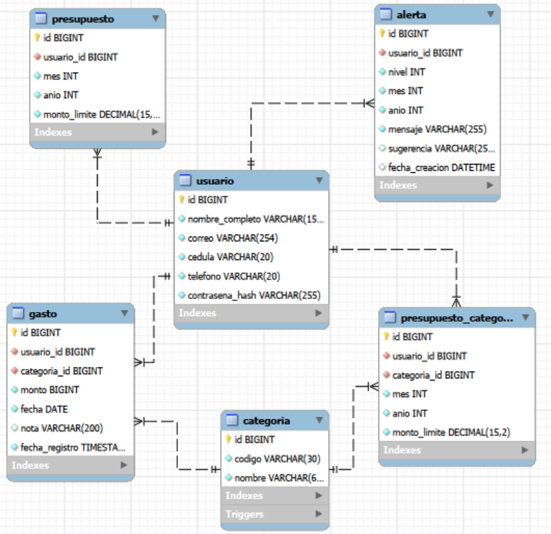

# Modelo de datos – Sprint 1 y Sprint 2

Responsable actual: Luis Fernando Salazar (Datos) · Subtareas: CFP-25 (Sprint 1) y CFP-30 (Sprint 2)
Motor: MySQL 8 · Scripts: db/schema.sql, db/migraciones/V2__presupuesto_y_alertas.sql, db/pruebas.sql y db/migraciones/pruebas_V2.sql

## Diagrama entidad-relación

## Entidades

| Entidad | Atributos | Estados | Relaciones | Restricción / RN |
|---|---|---|---|---|
| Usuario | id, nombre_completo, correo, cedula, telefono, contrasena_hash | No aplica | Tiene muchos gastos, presupuestos y alertas | Correo y cédula únicos; teléfono obligatorio (RF-01, Sprint 2); contraseña como hash (RNF-07); cada usuario solo ve sus datos (RNF-03) |
| Categoría | id, codigo, nombre | Catálogo fijo de 5 | Tiene muchos gastos y presupuestos por categoría | Solo ALIMENTACION, TRANSPORTE, ENTRETENIMIENTO, HOGAR u OTROS; tres triggers impiden crear, editar o borrar (RN-02, RN-03) |
| Gasto | id, usuario_id, categoria_id, monto, fecha, nota, fecha_registro | Registrado | Pertenece a un usuario y a una categoría | Monto > 0 (RN-01); fecha y categoría obligatorias; nota opcional de 200 caracteres (RN-08) |
| Presupuesto (Sprint 2) | id, usuario_id, mes, anio, monto_limite | Definido | Pertenece a un usuario | Gasto mensual del usuario (RF-07); uno por usuario y mes; monto > 0; mes de 1 a 12 |
| Presupuesto por categoría (Sprint 2) | id, usuario_id, categoria_id, mes, anio, monto_limite | Definido | Pertenece a un usuario y a una categoría | Gasto fijado por categoría (RF-07); uno por usuario, categoría y mes; monto > 0 |
| Alerta (Sprint 2) | id, usuario_id, nivel, mes, anio, mensaje, sugerencia, fecha_creacion | Generada | Pertenece a un usuario | Nivel 70, 80 o 90 (RF-09, RN-04); la misma alerta no se repite en el mes (CA-19); se reinicia cada mes (CA-20); incluye sugerencia (RN-06) |
| Total y porcentaje del mes (calculado) | Suma de montos por usuario y mes, y porcentaje sobre el presupuesto | — | Se calcula desde Gasto y Presupuesto | No se guarda, para que coincida con lo registrado (RN-07, RNF-01) |

## Relaciones

- USUARIO 1 ──< GASTO >── 1 CATEGORIA
- USUARIO 1 ──< PRESUPUESTO
- USUARIO 1 ──< PRESUPUESTO_CATEGORIA >── 1 CATEGORIA
- USUARIO 1 ──< ALERTA

## Cómo crear la base

1. En MySQL Workbench ejecutar db/schema.sql (crea cfp_dev, 3 tablas y 5 categorías).
2. Ejecutar db/migraciones/V2__presupuesto_y_alertas.sql (agrega presupuesto, presupuesto_categoria y alerta, y deja el teléfono obligatorio). Deben quedar 6 tablas.
3. Opcional: ejecutar db/pruebas.sql y luego CALL sp_cfp25_verificar(); (12 pruebas del Sprint 1), y db/migraciones/pruebas_V2.sql, cada INSERT con Ctrl + Enter (9 pruebas del Sprint 2).
4. Arrancar el backend después de crear la base.
5. Para empezar de cero en desarrollo: ejecutar db/reset.sql y repetir los pasos 1 y 2.

## Notas

- El backend valida que las tablas coincidan con sus entidades (ddl-auto=validate): todo cambio se coordina con Backend.
- Cada sprint agrega su propio script en db/migraciones (V2, V3…) sin modificar db/schema.sql.
- Las evidencias de las pruebas están en docs/evidencias/CFP-25/ (Sprint 1) y docs/evidencias/CFP-30/ (Sprint 2).